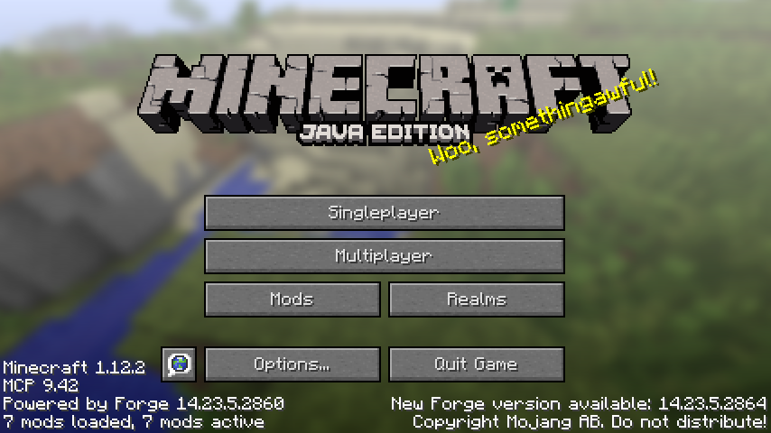
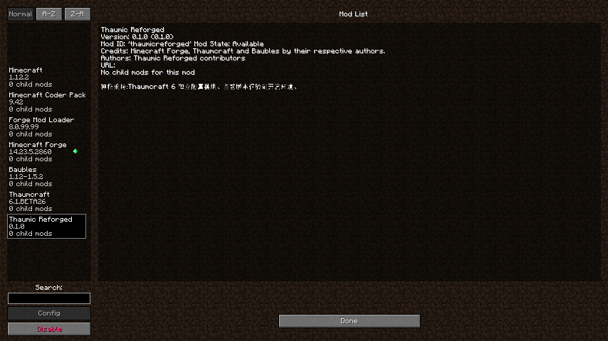

# 第一阶段实际验证记录

验证日期：2026-10-30，Asia/Shanghai。仅开发环境初始化与最小 API 链接验证；没有实现第二阶段玩法。

## 环境与工程

| 项目 | 实测结果 |
| --- | --- |
| 系统 | Fedora Linux 44，x86_64，内核 `7.2.11-200.fc44.x86_64` |
| 图形 | X11/XWayland 显示 `:0` 可用；AMD Radeon 780M，Mesa 26.2.4，OpenGL 4.6 |
| 系统默认 Java | OpenJDK `25.0.4.1` JRE；初始化前没有 `javac`，未改系统默认值 |
| 项目 Java | Temurin JDK `1.8.0_504-b01`，`.tools/jdk8`，`javac 1.8.0_504` |
| Gradle | 官方 MDK Wrapper `4.9`；无全局 Gradle |
| ForgeGradle | `3.0.197`，保持官方 MDK 的 3.x 主版本 |
| Minecraft / Forge | `1.12.2` / `14.23.5.2860` |
| Git | `2.56.0`；初始环境检查时为无提交、无远程的本地 `main`；后续仓库及分支约定见 [README](../README.md#git-仓库与分支) |
| 网络 | Forge Maven、Maven Central、Mojang libraries/resources、CurseMaven、CurseForge CDN、Adoptium/GitHub 均实际下载成功；使用项目进程代理与 TLS 1.2，偶发失败重试恢复 |

官方 MDK 的 `gradlew`、`gradlew.bat`、`gradle-wrapper.jar` 与下载包逐字节相同。Wrapper 配置只增加发行包 SHA-256。源码、资源与构建脚本通过 UTF-8 解码检查，shell 脚本通过 `bash -n`。

## 已执行命令与结果

| 命令 | 结果 |
| --- | --- |
| `./scripts/bootstrap-jdk8.sh` | 官方 JDK SHA-256 校验通过；Java / javac 均为 8u504 |
| `./scripts/gradle.sh --version` | Gradle 4.9，JVM 1.8.0_504 |
| `./scripts/gradle.sh clean build --console=plain` | `BUILD SUCCESSFUL in 25s`，9 个任务全部执行；[完整记录](evidence/clean-build.txt) |
| `./scripts/gradle.sh runClient --console=plain` | 真实图形客户端进入主菜单、7 个模组加载完成、正常退出；`BUILD SUCCESSFUL in 1m 3s`，退出码 0；[完整记录](evidence/client-baseline.txt) |
| `./scripts/run-client-mcp.sh --console=plain` | 带可选 MCP 的独立补充验证，8 个模组加载、HTTP 操作和退出通过；`BUILD SUCCESSFUL in 2m 9s`，退出码 0；工具限制见下文 |
| `./scripts/gradle.sh build --console=plain` | 最终构建 `BUILD SUCCESSFUL in 7s`；[完整记录](evidence/final-build.txt) |

最终构建保留 `verifyDevelopmentDependencies`、`compileJava`、`processResources`、`jar`、`downloadMcpConfig`、`extractSrg`、`createMcpToSrg`、`reobfJar`、`assemble`、`check`、`build` 流程。没有跳过关键任务。没有单元测试源码，Gradle 的 `test NO-SOURCE` 不作为游戏验证依据。

开发过程中确实遇到并修复了脚本兼容错误、映射依赖解析顺序、Forge Side helper、Thaumcraft AT、源码运行元数据与退出 daemon 问题；这些失败没有被当成完成。原因与调整见 [COMPATIBILITY.md](COMPATIBILITY.md)。原始中间日志保存在被忽略的 `.tools/verification/`。

## JAR 与 API

- 产物：`build/libs/thaumicreforged-0.1.0.jar`，2664 字节。
- SHA-256：`a13d424f274aba7606a88c089927ebc5aa95d0a12e261c66234c937cb6de98e4`。
- 对应校验文件：`build/libs/thaumicreforged-0.1.0.jar.sha256`。JAR ZIP CRC 检查通过。
- 唯一 class：`io/github/thaumicreforged/ThaumicReforged.class`，major version 52，即 Java 8。
- 资源：展开后的 `mcmod.info`、`pack.mcmeta`，版本为 `0.1.0`、Minecraft `1.12.2`；没有残留占位符。
- 无 Thaumcraft、Baubles、Forge、Minecraft、MCP 工具、验证探针 class，无嵌套 JAR，也无复制的 `tc_at.cfg`。
- [完整 JAR 清单及元数据](evidence/artifact.json)。

真实编译引用 `thaumcraft.api.aspects.Aspect.AIR.getTag()` 与 `baubles.api.BaubleType.RING.name()`。两个依赖都在编译及开发运行 classpath，经过 FG3 重映射；Thaumcraft 原件与官方发布二进制的 SHA-256 一致。运行时日志进一步证实类与方法可链接：

```text
[14:36:27] ... Thaumic Reforged 0.1.0: pre-initialization
[14:36:32] ... Public API linkage OK: Thaumcraft Aspect.AIR=aer, Baubles BaubleType.RING=RING
[14:36:33] ... Thaumic Reforged 0.1.0: initialization complete (environment validation only)
[14:36:33] ... Forge Mod Loader has successfully loaded 7 mods
```

精确日志时间以[原始客户端记录](evidence/client-baseline.txt)为准。

## 基线客户端验收

实际启动的是 ForgeGradle `runClient` 的 Minecraft 客户端，不是仅做静态检查或专用服务端替代验证。

| Mod ID | 实际版本 | Loader 状态 |
| --- | --- | --- |
| `minecraft` | `1.12.2` | Available |
| `mcp`（Forge 内置 Coder Pack） | `9.42` | Available |
| `FML` | `8.0.99.99` | Available |
| `forge` | `14.23.5.2860` | Available |
| `baubles` | `1.5.2` | Available |
| `thaumcraft` | `6.1.BETA26` | Available |
| `thaumicreforged` | `0.1.0` | Available |

`thaumicreforged` 的运行时 metadata `autogenerated=false`；Mods 详情页显示正确名称、版本、Mod ID、作者及描述。基线验证没有安装可选 MCP Mod。

为避免 Wayland 桌面焦点影响，基线使用项目外部临时 JDK Attach 验证探针，在客户端线程读取 Loader 和 Side 状态，并调用 Forge 自带的 `GuiModList` 展示实际 Mods 页；探针位于 `.tools/verification`，不属于模组源码或交付物。截图直接来自真实游戏窗口。补充 MCP 验证则实际按按钮 ID 打开/退出 Mods 页。

运行时证据：[runtime-probe.txt](evidence/runtime-probe.txt)。其中 `Side.values()` 确认为 `[CLIENT, SERVER]`，来源为未修改的官方 MergeTool 0.2.3.3 helper。





## 可选 Minecraft Mod MCP 验证

- 来源：用户提供的 [langyo/minecraft-mod-mcp](https://github.com/langyo/minecraft-mod-mcp)。
- 固定 [v0.4.20 release](https://github.com/langyo/minecraft-mod-mcp/releases/tag/v0.4.20) 的 `minecraft-mcp-1.12.2-forge-v0.4.20.jar`，SHA-256 与该发布页一致：`ca558950c834352e17ad62d75e18a7435a9a7fae5727d1136d5934ef9da94fc3`。
- 通过 `/api/status` 确认 `version=0.4.20`、`loader=forge`；`get_screen_buttons`、`enter_control_mode`、`click_button_id`、`screenshot_to_file` 实际返回成功。
- 实际从主菜单打开 Mods，返回主菜单，再通过 Quit Game 按钮退出；Gradle 完整成功。
- [HTTP 操作回执](evidence/mcp-ui-probe.json)。使用的是上游支持的本地 HTTP 接口，未声称已向 Codex 动态注册 MCP 工具；未更改 Codex 全局配置，未安装全局 npm 包。
- 脚本退出后，`run/mods` 中该 MCP JAR 已自动删除。正常基线依赖和输出 JAR 都不包含它。

## 已知问题与尚未验证内容

1. **上游资源日志仍存在**：BETA26 模型引用中出现 5 个错误纹理路径（包含反斜杠或重复 `.png`），以及 `thaumcraft:runicshieldcharge` 音效缺失警告。它们未导致本次初始化崩溃，未修改 Thaumcraft 原件来消除。Minecraft 官方资源索引的 1290 个唯一对象均已逐个通过大小和 SHA-1 校验，见[记录](evidence/assets.txt)。
2. **旧 Forge 开发提示**：仍输出 Maven 库缓存目录布局及开发包签名数据提示；实际随后进入 `Available`，不是零 ERROR 级日志验收。
3. **可选 MCP 限制**：通用 `select_list_item` 对旧 `GuiModList` 返回 `no children() on GuiModList`；截图/控制期间出现 Mesa OpenGL `1282: Invalid operation`，首次截图可能捕捉上一帧。已验证能输出截图文件和完成按钮导航，不将其截图稳定性视为通过。此 GL 错误未出现在不带 MCP 的基线日志。
4. **网络**：本机代理偶发单文件 TLS 握手失败；重新执行原命令恢复。其他网络环境是否需要代理由开发者本地配置决定。
5. **未验证**：Windows/macOS、独立打包玩家客户端、专用服务端、进入世界后的游戏流程。这些未作为本阶段通过项。没有进行玩法、节点、研究、法杖或多方块功能开发。

第一阶段要求的真实构建、有效 JAR、四个指定组件在图形开发客户端正常加载、公开 API 编译与运行链接均已验证。
